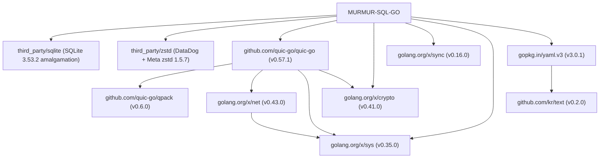

# Third-Party Vendors and Dependencies

This document tracks all third-party code vendored into or imported by MURMUR-SQL-GO, along with upstream origins, versions, licenses, usages, and transitive dependencies, per the project's dependency policy.

---

## Dependency Policy and Architecture Principles

MURMUR-SQL-GO enforces a strict, hierarchical dependency policy:

1. **Standard Library First:** Go's standard library is used for networking, PostgreSQL wire protocol framing, TLS 1.3 / X.509, logging, HTTP status/metrics endpoints, JSON formatting, tar/zip archive transfers, cryptographic hashing ([`crypto/sha256`](file:///home/marc/MURMUR-SQL-GO/auth/auth.go) for passphrase-derived unlock keys), and process lifecycle management. No external PostgreSQL-server framework, logging framework, CLI parser, or service framework is linked into the server binaries.
2. **Go Project and Major Corporate Support Second:** When standard library functionality is unavailable, packages maintained by the Go Authors / Google (`golang.org/x/*`) or established corporate contributors (DataDog, Meta) are prioritized.
3. **Independent Packages Kept to an Absolute Minimum:** Independent third-party modules are permitted only when no standard or Go-project package exists and strict functional requirements mandate them ([`gopkg.in/yaml.v3`](https://github.com/go-yaml/yaml) for full YAML 1.2 specification compliance and AST comment preservation).
4. **Zero External Sibling Repositories:** The core embedded database engine ([`murmur`](file:///home/marc/MURMUR-SQL-GO/murmur), [`murmur/spool`](file:///home/marc/MURMUR-SQL-GO/murmur/spool), [`murmur/replication`](file:///home/marc/MURMUR-SQL-GO/murmur/replication)) is part of this repository under `murmur/`, making it fully self-contained.

---

## 1. Vendored C and Go Libraries (`murmur/third_party/`)

MURMUR-SQL-GO vendors specific low-level libraries directly in `murmur/third_party/` to satisfy exact feature requirements (such as SQLite session extensions) and ensure reproducible, zero-system-dependency builds.

### 1.1. SQLite Amalgamation
* **Path:** [`murmur/third_party/sqlite`](file:///home/marc/MURMUR-SQL-GO/murmur/third_party/sqlite)
* **Version:** `3.53.2`
* **License:** Public Domain
* **Upstream:** [SQLite Project](https://www.sqlite.org) (bundled via `libsqlite3-sys` 0.38.2)
* **Files Vendored:** `sqlite3.c`, `sqlite3.h`, `sqlite3ext.h` (copied verbatim)
* **Used by:** [`murmur/internal/sqlite`](file:///home/marc/MURMUR-SQL-GO/murmur/internal/sqlite) via Cgo
* **Purpose:**
  Provides the embedded in-memory database engine with change capture, custom authorizers, scalar functions, and full-text search. Compiled with:
  * `SQLITE_ENABLE_SESSION` (change capture & changesets)
  * `SQLITE_ENABLE_PREUPDATE_HOOK` (row preupdate interception)
  * `SQLITE_ENABLE_FTS5` (full-text search)
  * `SQLITE_ENABLE_COLUMN_METADATA` (column metadata inspection)
  * `SQLITE_THREADSAFE=1` (serialized threading mode)
* **Dependencies:**
  * Standard C library (`libc`)
  * Math library (`libm`, via `-lm`)

---

### 1.2. DataDog zstd Go Driver + Meta zstd C Library
* **Path:** [`murmur/third_party/zstd`](file:///home/marc/MURMUR-SQL-GO/murmur/third_party/zstd)
* **Version:** `v1.5.7` (Go driver `v1.5.7`, Meta `zstd` C library `1.5.7`)
* **License:**
  * Go Driver: Simplified BSD (2-Clause) License
  * Meta C Library: BSD (3-Clause) License
* **Upstream:**
  * Go driver: [DataDog/zstd](https://github.com/DataDog/zstd)
  * C engine: [Meta/facebook/zstd](https://github.com/facebook/zstd)
* **Go Module Mapping:**
  Pinned via `replace` directive in [`go.mod`](file:///home/marc/MURMUR-SQL-GO/go.mod):
  ```go
  replace github.com/DataDog/zstd => ./third_party/zstd
  ```
* **Used by:**
  * [`compression/zstd.go`](file:///home/marc/MURMUR-SQL-GO/compression/zstd.go)
  * [`spool/compression.go`](file:///home/marc/MURMUR-SQL-GO/spool/compression.go)
* **Purpose:**
  Implements the standard `sqlite-session-zstd-v1` compression codec (codec ID 128) used for Spool blocks and replication session wire payload compression.
* **Dependencies:**
  * Standard C library (`libc`)
  * POSIX threading / C compiler builtins for multithreading and CPU feature detection (`huf_decompress_amd64.S`, etc.)

---

## 2. Direct Go Module Dependencies (`go.mod`)

| Module | Version | License | Upstream / Maintainer | Purpose in MURMUR-SQL-GO |
| :--- | :--- | :--- | :--- | :--- |
| **`github.com/quic-go/quic-go`** | `v0.57.1` | MIT | [quic-go](https://github.com/quic-go/quic-go) (Marten Seemann and contributors) | Masterless peer-to-peer replication transport protocol ([`replication/transport_quic.go`](file:///home/marc/MURMUR-SQL-GO/replication/transport_quic.go)). |
| **`github.com/DataDog/zstd`** | `v1.5.7` | BSD-2-Clause / BSD-3-Clause | DataDog / Meta (vendored in [`third_party/zstd`](file:///home/marc/MURMUR-SQL-GO/third_party/zstd)) | High-throughput compression codec for Spool block persistence and network synchronization payloads. |
| **`golang.org/x/crypto`** | `v0.41.0` | BSD-3-Clause | Go Authors (Google) | Argon2id and Argon2i PHC password hashing ([`auth/password.go`](file:///home/marc/MURMUR-SQL-GO/auth/password.go)), HKDF key expansion, and XChaCha20-Poly1305 block encryption. |
| **`golang.org/x/sync`** | `v0.16.0` | BSD-3-Clause | Go Authors (Google) | Concurrency primitives (`errgroup`, `semaphore`) for replication pipelines and background maintenance. |
| **`golang.org/x/sys`** | `v0.35.0` | BSD-3-Clause | Go Authors (Google) | Platform-specific system calls (advisory file locking, filesystem disk space stats, CPU detection) and Windows Service Control Manager (SCM) service integration ([`service/`](file:///home/marc/MURMUR-SQL-GO/service)). |
| **`gopkg.in/yaml.v3`** | `v3.0.1` | MIT / Apache-2.0 | [go-yaml/yaml](https://github.com/go-yaml/yaml) (Gustavo Niemeyer and contributors) | Full YAML 1.2 parsing, validation, encoding, and AST manipulation (`yaml.Node`) for server configuration files ([`config/config.go`](file:///home/marc/MURMUR-SQL-GO/config/config.go), [`config/save.go`](file:///home/marc/MURMUR-SQL-GO/config/save.go), [`config.example.yaml`](file:///home/marc/MURMUR-SQL-GO/config.example.yaml), and `--validate-config` in [`cmd/murmur-server`](file:///home/marc/MURMUR-SQL-GO/cmd/murmur-server)). |

### Justification for Independent Packages

* **`gopkg.in/yaml.v3`:** YAML is not part of the Go standard library or `golang.org/x/*`. `gopkg.in/yaml.v3` provides complete YAML 1.2 specification compliance and an Abstract Syntax Tree (AST) node model (`yaml.Node`) that preserves comments, structure, and formatting during runtime configuration updates (such as table replication updates via `MURMUR SET TABLE ... REPLICATED`). It has zero runtime external dependencies outside of standard library primitives.
* **Passphrase Derivation (`crypto/sha256`):** Database master unlock key derivation from user passphrases (`MURMUR UNLOCK KEY 'secret'` and `bin/murmur-admin --passphrase`) uses Go's standard library [`crypto/sha256`](file:///home/marc/MURMUR-SQL-GO/auth/auth.go), avoiding any external hashing libraries or CPU feature-detection dependencies.

---

## 3. Client Runtime Dependencies (`clients/`)

Client libraries provide SDKs for application developers to connect over the PostgreSQL wire protocol. Their dependencies are strictly isolated to client directories and are **not linked into the server binaries** (`murmur-server` or `murmur-admin`).

| Client | Module / Dependency | Version | License | Upstream / Maintainer | Purpose |
| :--- | :--- | :--- | :--- | :--- | :--- |
| **Go** ([`clients/go`](file:///home/marc/MURMUR-SQL-GO/clients/go)) | `github.com/marcgauthier/pq` (fork of `github.com/lib/pq`) | `v1.10.9` (fork `v0.0.0-20260820222753-451ac10e4e85`) | MIT | 'pq' Contributors / fork by Marc Gauthier | PostgreSQL wire protocol client driver for the Go SDK. Forked to ensure exact SQLSTATE and driver compatibility. |
| **Python** ([`clients/python`](file:///home/marc/MURMUR-SQL-GO/clients/python)) | `pg8000` | `>=1.31,<2` | BSD-3-Clause | Tony Hermansky / pg8000 contributors | Pure-Python PostgreSQL wire client driver without libpq C library requirements. |
| **Rust** ([`clients/rust`](file:///home/marc/MURMUR-SQL-GO/clients/rust)) | `tokio`, `tokio-postgres`, `rustls` | `1.x`, `0.7`, `0.23` | MIT / Apache-2.0 / ISC | Tokio / Rustls contributors | Pure-Rust async PostgreSQL client library and TLS 1.3 transport. |

---

## 4. Transitive and Indirect Dependencies

The following modules are loaded transitively by the direct dependencies:

### 4.1. Required by `github.com/quic-go/quic-go`
* **`github.com/quic-go/qpack`** (`v0.6.0`)
  * **License:** MIT
  * **Purpose:** QPACK header compression format for QUIC streams.
* **`golang.org/x/net`** (`v0.43.0`)
  * **License:** BSD-3-Clause
  * **Maintainer:** Go Authors (Google)
  * **Purpose:** Low-level UDP socket options and packet buffers utilized by `quic-go`.

### 4.2. Required by `gopkg.in/yaml.v3`
* **`github.com/kr/text`** (`v0.2.0`)
  * **License:** MIT
  * **Purpose:** Text formatting and error formatting used internally by `yaml.v3`.

---

## 5. Test and Development Tooling Dependencies

Used exclusively during testing, mocking, or test harness execution:

| Module | Version | License | Usage |
| :--- | :--- | :--- | :--- |
| **`github.com/stretchr/testify`** | `v1.11.1` | MIT | Assertion and testing utilities across test suites. |
| **`github.com/davecgh/go-spew`** | `v1.1.1` | ISC | Deep pretty-printer used by `testify`. |
| **`github.com/pmezard/go-difflib`** | `v1.0.0` | BSD-3-Clause | Unified diff generation in test failure reporting. |
| **`go.uber.org/mock`** | `v0.5.2` | Apache-2.0 | Mock generation and interface stubs in tests. |
| **`github.com/jordanlewis/gcassert`** | `v0.0.0-20250430164644-389ef753e22e` | Apache-2.0 | Compiler escape analysis assertions in memory-critical paths. |
| **`golang.org/x/time`** | `v0.12.0` | BSD-3-Clause | Rate limiting utilities used in integration test harnesses. |

---

## 6. Dependency Graph Summary


